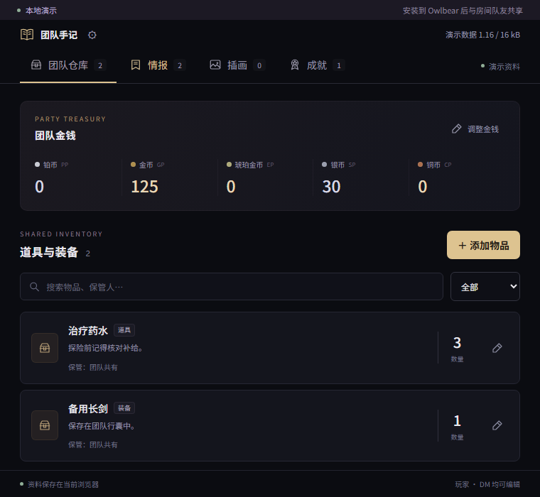
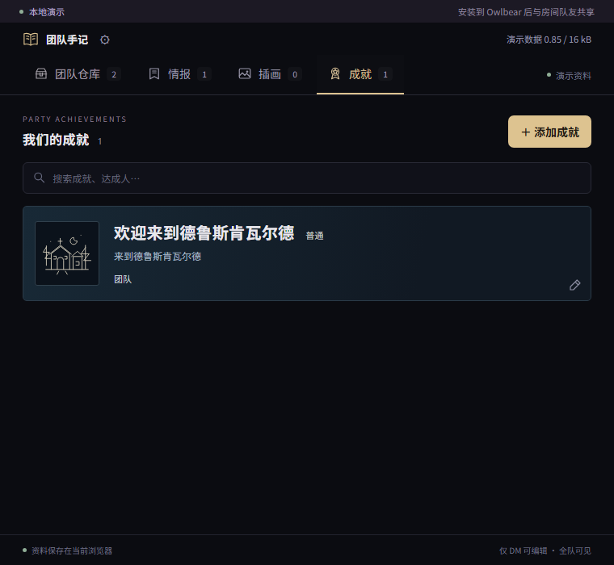

<h1 align="center">📖 团队手记</h1>

Owlbear Rodeo 团队资料插件 · Team Journal

  
  
  

  <a href="https://owlbear-twisted-moon.pages.dev/">产品主页</a> ·
  <a href="https://owlbear-twisted-moon.pages.dev/panel.html">打开演示</a> ·
  <a href="#快速安装">安装指南</a> ·
  <a href="https://github.com/exIncognitor/owlbear-team-journal/issues">问题反馈</a>

在 Owlbear 房间里共同整理团队金钱、道具装备、调查情报、旅途插画与成就。点击书本图标展开 760 × 700 黑底面板，玩家和 DM 共同编辑公开资料，DM 管理私密插画和团队成就。

## 界面预览

### 团队仓库

五类钱币分别记账，道具与装备可以记录数量、保管人和说明。

查看成就列表

长条卡片以文字为主，配以简单插画，显示名称、达成人、描述和品质。

截图来自 v0.3.3 独立演示，使用示例资料。真实新房间从空白手记开始，成就由 DM 添加。

## 快速安装

1. 复制下方安装链接。
2. 在 Owlbear Rodeo 的扩展管理中添加该链接，并在房间中启用“团队手记”。
3. 点击书本图标打开面板，再次点击即可关闭。
4. 从团队仓库、情报或插画开始记录资料。DM 可在成就页添加团队里程碑。

~~~text
https://owlbear-twisted-moon.pages.dev/manifest.json
~~~

发布新版本后，刷新整个 Owlbear 房间即可加载更新。[安装清单](https://owlbear-twisted-moon.pages.dev/manifest.json)

也可以先打开独立演示体验编辑操作。演示默认以 DM 身份使用当前浏览器的本地数据，主动连接云端后会读写所选资料库。[独立演示](https://owlbear-twisted-moon.pages.dev/panel.html)

## 四个资料栏目

| 栏目 | 可以记录的内容 | 交互方式 |
| --- | --- | --- |
| 团队仓库 | 铂币、金币、琥珀金币、银币、铜币，以及道具和装备 | 调整余额、记录数量与保管人、搜索和分类筛选 |
| 情报 | 线索、人物、地点和其他资料 | 多行正文、跟进与已整理状态、搜索 |
| 插画 | 图片链接、标题和说明 | Owlbear 图库选择、HTTPS 直链导入、大图查看、全队展示 |
| 成就 | 名称、达成人、描述、品质和配图链接 | 深色长条列表，DM 维护，全队查看 |

“展示给全队”会同步插画页中的当前展示，队友打开插画页即可查看。

## 玩家与 DM 权限

| 操作 | 玩家 | DM |
| --- | --- | --- |
| 查看、编辑团队金钱、道具装备与情报 | ✓ | ✓ |
| 添加、编辑公开插画和设置当前展示 | ✓ | ✓ |
| 设置插画为“仅 DM 可见”并查看私密收藏 | — | ✓ |
| 查看成就 | ✓ | ✓ |
| 添加、编辑、移除成就 | — | ✓ |
| 配置存储来源、云端连接与模组资料库 | — | ✓ |

DM 添加插画默认选择“仅 DM 可见”，玩家添加的插画默认公开。私密插画公开后可以展示给全队，重新隐藏时会结束该图片的全队展示，并关闭玩家已打开的大图。已经查看或保存的图片副本无法撤回。

## 数据存在哪里

DM 可以通过顶栏齿轮切换当前房间的存储来源。

| 数据 | 枭雄房间模式 | 云端模式 |
| --- | --- | --- |
| 团队仓库、金钱、情报、公开插画、成就 | 当前房间的共享 metadata | 所选云端模组的 Cloudflare D1 数据库 |
| DM 私密插画 | 当前 DM 浏览器，按账号和房间区分 | 独立私密表，按模组、房间和 DM 账号区分 |
| 图片原文件 | 来源 Owlbear 图库或外部图床 | 来源 Owlbear 图库或外部图床 |
| 容量显示 | 整个房间的共享占用 | 当前模组共享资料占用 |

- **按房间设置**。新房间默认使用自己的房间共享数据。DM 的来源选择只作用于当前房间，玩家跟随该房间的设置。
- **按模组整理**。一个云端连接下可以建立多个模组资料库。两个房间由 DM 主动选择同一个云端模组时，共享该模组的公开资料。
- **切换与复制分开**。“切换并保留原资料”更换读取和保存位置。需要迁移公开资料时，使用“复制当前资料到所选目标”，目标必须为空。
- **恢复私密资料**。房间模式的本机私密插画会随网站数据清除而丢失。云端私密记录可以在同一房间和 DM 账号下跨设备恢复，需重新导入匹配的管理配置。
- **图片只保存引用**。插画和成就保存 URL、文字与必要信息，图片原文件由图库或图床托管。

首次连接、资料复制、私密恢复和自建后端的步骤见 [云端存储指南](CLOUD-STORAGE.md)。

### 容量与同步

Owlbear 房间的 16 kB metadata 由全部插件共享。团队手记按 UTF-8 字节计算占用，普通写入保留切换所需余量。云端业务资料单独保存在 D1，房间仍需少量空间存放连接与刷新信息。

房间资料按条目独立保存，编辑前检查版本。完全同时修改同一条房间记录时，仍可能由最后一次写入覆盖。云端使用资料库 revision 与 D1 原子条件更新拒绝陈旧写入，并以房间通知和轮询同步已打开的面板。

客户端依据 Owlbear SDK 的真实角色控制界面操作。公开 room metadata 本身缺少服务端角色写入隔离。云端私密接口与管理操作使用管理私钥签名授权，配置持有者可以管理该后端的全部模组和私密资料。管理配置应由 DM 妥善保存。[权限与后端授权说明](CLOUD-STORAGE.md)

## 图片导入

**从图库选择**会直接打开 Owlbear 官方图片选择器。图片需要已存在于 Owlbear 图库，选择器可以切换角色、地图等类型。

**从链接导入**使用可以直接访问图片的 HTTPS URL。公开 GitHub 仓库中的 Raw 图片直链也可使用，私有图片需要相应的访问授权。成就配图同样通过 HTTPS 链接添加。

## 最近更新

### v0.3.3

- 修复图库因空 `defaultSearch` 被宿主拒绝而无法打开的问题。
- 真实空房间从已保存资料读取成就，独立演示提供欢迎示例。
- 图库失败显示具体原因，取消后恢复操作，支持再次选择。

该版本通过 47 项逻辑与本地 D1 测试、14 组浏览器回归及完整构建。Chrome 真实 Owlbear 房间已验证图库打开、选图返回、取消和空房间成就。10 个公开静态文件的生产哈希与发布构建一致。[验证记录](TEST-REPORT.md) · [部署记录](DEPLOY.md)

## 本地开发

需要 Node.js 22.12 或更高版本和 npm。

~~~sh
git clone https://github.com/exIncognitor/owlbear-team-journal.git
cd owlbear-team-journal
npm ci
npm run dev -- --host 127.0.0.1 --port 5183
~~~

开发服务器启动后，打开终端显示的 `/panel.html` 地址即可体验本地演示。

### 验证与构建

~~~sh
npm test
npm run build
npm run test:e2e
~~~

浏览器回归需要 Playwright 对应的 Chromium，首次使用时可运行 `npx playwright install chromium`。`npm run build` 执行 TypeScript 检查、Vite 构建和 Worker 打包，产物位于 `dist/`。

### 项目结构

~~~text
src/                    面板、资料模型、权限与存储路由
server/worker.ts        Cloudflare D1 接口与签名授权
public/manifest.json    Owlbear 扩展安装清单
public/icon.svg         书本图标
tests/                  浏览器与多客户端回归
scripts/                云端配置与 Worker 构建工具
docs/images/            README 演示截图
~~~

内部资料键使用 `io.twisted-moon.v1/` 命名空间，演示数据键为 `twisted-moon.demo.v1`。开发涉及数据格式时，需要兼容已保存记录。

### 自行部署

前端和已编译 Worker 通过 Cloudflare Pages Direct Upload 发布，云端模式需要绑定 D1 数据库并配置管理公钥。GitHub 源码推送与 Pages 发布分别执行。首次部署流程及配置说明见 [云端存储指南](CLOUD-STORAGE.md) 和 [部署记录](DEPLOY.md)。

## 反馈与参考

反馈问题时，请说明插件版本、存储模式、DM 或玩家身份、复现步骤和错误提示。截图可以帮助定位问题，请遮盖管理配置与私密战役内容。[提交问题](https://github.com/exIncognitor/owlbear-team-journal/issues)

- [Owlbear 原生 Action API](https://docs.owlbear.rodeo/extensions/apis/action/)
- [Owlbear 房间 metadata](https://docs.owlbear.rodeo/extensions/apis/room/)
- [Owlbear 图库 API](https://docs.owlbear.rodeo/extensions/apis/assets/)
- [Owlbear 玩家角色与事件](https://docs.owlbear.rodeo/extensions/apis/player/)
